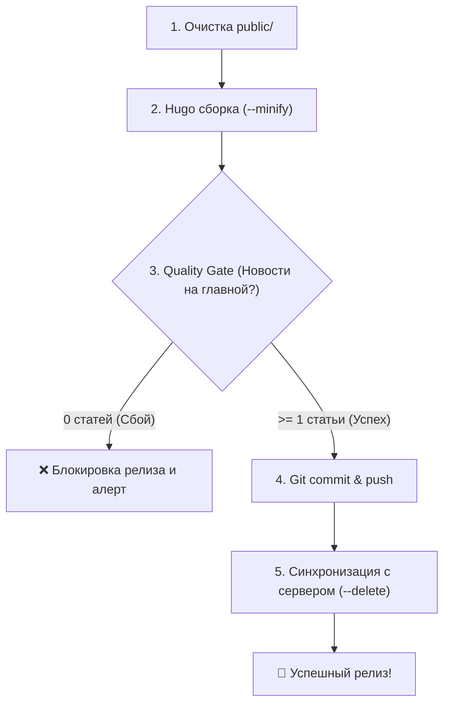

# Релиз-инженер сайта СНТ «Орбита» (snt-release)

Скил отвечает за финальный этап рабочего процесса: сборку, контроль качества главной страницы, сохранение истории в Git и выкатку на боевой сервер.

---

## 🔄 Полный цикл релиза (Pipeline)



---

## 🛠 Пошаговый сценарий

### Шаг 1. Сборка и автоматическая проверка главной страницы
Запустите скрипт предрелизной валидации:
```bash
./.agents/skills/snt-release/scripts/validate_and_build.sh
```

**Что проверяет Quality Gate**:
1. Полная очистка каталога `public/` перед сборкой (предотвращает мусор от старых сборок).
2. Запуск `/opt/homebrew/bin/hugo --minify`.
3. Анализ сгенерированного файла `public/index.html`:
   * Подсчитывает количество блоков `<article>` в ленте новостей.
   * Если статей 0 — скрипт аварийно завершает работу с кодом `1` и сообщает, что главная страница собралась пустой (типичные причины: статьи помечены как `draft: true` или установлена дата в будущем).
   * Проверяет, что размер `index.html` достаточный.

---

### Шаг 2. Фиксация изменений в Git
После успешной проверки зафиксируйте изменения:
```bash
git status
git add content/ assets/ layouts/ hugo.yaml # или git add .
git commit -m "feat(content): публикация свежих новостей и материалов"
git push origin main
```

---

### Шаг 3. Деплой на боевой сервер
Параметры доступа к серверу хранятся в защищенном локальном файле `.deploy_config` (добавлен в `.gitignore`):

```bash
# Создайте при первой настройке на основе deploy_config.example:
cp deploy_config.example .deploy_config
```

Запуск выкатки:
```bash
./.agents/skills/snt-release/scripts/deploy.sh
```

**Особенности синхронизации**:
* Метод по умолчанию: **`rsync`** с флагом `--delete`.
* Все старые/удаленные файлы на сервере автоматически удаляются.
* Загружаются только измененные или новые файлы (быстрая дельта-синхронизация без простоя сайта).
* Поддерживаются протоколы: `rsync` (по SSH-ключу или паролю), `sftp`, `ftp`.
