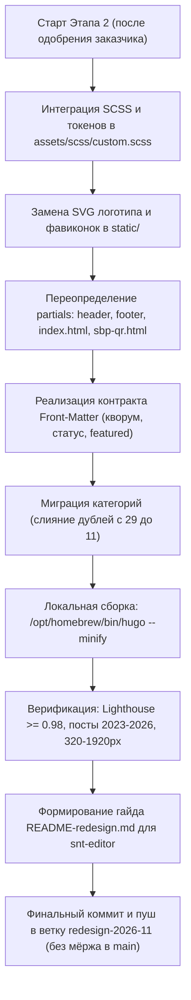

# План внедрения редизайна сайта СНТ «Орбита» (Этап 2)

> **Статус:** подготовлен по итогам Этапа 1 (прототипирование, векторная графика и арт-директорский аудит).  
> **Исполнители:** Hugo-инженер (`snt-tech`) + Редактор (`snt-editor`) + Релиз-мастер (`snt-release`).  
> **Ветка:** `redesign-2026-11` (строго без прямого мёржа в `main`).

---

## 1. Архитектурное решение: корневые переопределения vs `themes/orbita/`

### Сравнение подходов

| Критерий | Вариант 1: Отдельная тема `themes/orbita/` | Вариант 2: Переопределения в `layouts/` + `assets/` (РЕКОМЕНДОВАНО) |
|---|---|---|
| **Правила GEMINI.md** | Нарушает базовое правило о недопустимости дублирования темы и вмешательства в подмодуль | Строго следует правилу проекта: тема Stack остаётся нетронутым Git-подмодулем |
| **Объём кодовой базы** | Дублирование ~120 файлов шаблонов, локализации, поиска, сборщика ассетов | Изменяются только целевые partials (~6 файлов) и файл стилей `custom.scss` |
| **Обратная совместимость** | Высокий риск сломать скрытые зависимости Stack (шорткоды, пагинация, Pagefind) | 100% совместимость: весь внутренний движок Stack продолжает штатно работать |
| **Сложность поддержки** | При обновлении Hugo или правках темы нужно синхронизировать весь форк | Чистый и прозрачный diff: видны только кастомные изменения сайта «Орбита» |

### 🎯 Выбор и обоснование
**Выбран Вариант 2: переопределения в корне проекта (`layouts/` + `assets/scss/custom.scss`).**  
Тема `themes/hugo-theme-stack/` остаётся подключённым Git-подмодулем без каких-либо правок внутри. Все компоненты нового фирменного стиля накладываются поверх неё через стандартный механизм каскадного переопределения Hugo:
* `assets/scss/custom.scss` — дизайн-токены бренда, сетки, компоненты баннера, виджета статуса СНТ, модального окна СБП, режима доступности «А+» и стили тёмной темы.
* `layouts/index.html` — переопределение главной страницы (срочный баннер кворума, виджет «Статус СНТ сегодня», быстрые действия, лента новостей featured + compact list, архив).
* `layouts/partials/header/` — шапка с векторным SVG-логотипом, статусом экстренной связи, кнопками «А+», поиска и переключателя темы.
* `layouts/partials/footer/` — футер с векторным логотипом, контактами правления, реквизитами и копирайтом.
* `layouts/partials/modals/sbp-qr.html` — модальное окно с векторным SVG QR-кодом СБП и копированием реквизитов в 1 клик.
* `static/orlogo.svg`, `static/logo_fav.png` — замена фавиконок и векторного логотипа.

> [!IMPORTANT]
> **Исключение по требованию заказчика:**
> Интерактивный мини-калькулятор передачи показаний электросчётчиков **НЕ РЕАЛИЗУЕТСЯ** на Этапе 2. Плитка «Электроэнергия» ведёт на информационный раздел `/electro/` с тарифами и контактами сбыта.

---

## 2. «Контракт данных»: параметры Front-Matter и `hugo.yaml`

Чтобы новый дизайн был на 100% управляемым из Markdown-файлов без вмешательства редактора в HTML-шаблоны, вводится стандартизированный контракт данных.

### 2.1. Срочное объявление и кворум общего собрания (Hero Announcement)

Управляется через Front-Matter соответствующей публикации в `content/post/<slug>/index.md`.

#### Параметры Front-Matter:
* `banner_urgent: true` (boolean) — активация срочного баннера на главной.
* `banner_badge: "ОБЩЕЕ СОБРАНИЕ"` (string) — текст статусного бейджа.
* `banner_title: "Выборы органов управления и утверждение сметы 2026"` (string) — заголовок баннера.
* `banner_subtitle: "Заочное голосование членов СНТ «Орбита»..."` (string) — краткое пояснение.
* `banner_expires: 2026-06-21T00:00:00+03:00` (ISO 8601) — автоматическое скрытие баннера по истечении даты.
* `banner_icon: "megaphone"` (string) — идентификатор векторной иконки (`megaphone`, `vote`, `alert`).
* **Параметры шкалы кворума:**
  * `quorum_collected: 142` (integer) — количество проголосовавших участков на текущий момент.
  * `quorum_total: 210` (integer) — общее число участков товарищества с правом голоса.
  * `quorum_threshold_pct: 50` (integer, по умолчанию `50`) — порог легитимности по 217-ФЗ (для отметки на шкале).
  * `quorum_days_left: 14` (integer) — количество дней до окончания приёма бюллетеней.
* **Двойные кнопки действия (Dual CTA):**
  * `banner_cta_primary_text: "Скачать бюллетень (PDF, 240 КБ)"` (string)
  * `banner_cta_primary_url: "/docs/bulleten-2026.pdf"` (string)
  * `banner_cta_secondary_text: "Повестка и смета 2026 →"` (string)
  * `banner_cta_secondary_url: "/p/vybory-2026-smeta/"` (string)

#### Пример Front-Matter статьи:
```yaml
---
title: "Общее заочное голосование членов СНТ «Орбита» 2026"
date: 2026-05-15T10:00:00+03:00
slug: "obshchee-golosovanie-2026"
categories: ["Выборы", "Важное"]

banner_urgent: true
banner_badge: "ОБЩЕЕ СОБРАНИЕ"
banner_title: "Выборы органов управления и утверждение сметы 2026"
banner_subtitle: "Заочное голосование членов СНТ «Орбита» с 15 мая по 20 июня 2026 года"
banner_expires: 2026-06-21T00:00:00+03:00
banner_icon: "megaphone"

quorum_collected: 142
quorum_total: 210
quorum_threshold_pct: 50
quorum_days_left: 14

banner_cta_primary_text: "Скачать бюллетень (PDF, 240 КБ)"
banner_cta_primary_url: "/docs/bulleten-2026.pdf"
banner_cta_secondary_text: "Повестка и смета 2026 →"
banner_cta_secondary_url: "/p/obshchee-golosovanie-2026/"
---
```

---

### 2.2. Виджет оперативной сводки «Статус СНТ сегодня»

Настраивается централизованно в `hugo.yaml` (в блоке `params.statusWidget`):

```yaml
params:
  statusWidget:
    enable: true
    title: "Статус СНТ сегодня"
    items:
      - id: "power"
        label: "Электросеть"
        value: "220 В / 15 кВт"
        note: "Аварий нет, в норме"
        status: "ok" # ok, warning, alert
        icon: "zap"
      - id: "trash"
        label: "Вывоз мусора"
        value: "ПУХТО заменено"
        note: "По графику (Пн, Чт, Сб)"
        status: "ok"
        icon: "trash"
      - id: "water"
        label: "Водопровод и въезд"
        value: "Летний запущен"
        note: "Ворота и шлагбаум работают"
        status: "ok"
        icon: "droplet"
      - id: "board"
        label: "Приём правления"
        value: "Суббота 11:00–14:00"
        note: "Дежурный в сторожке"
        status: "info"
        icon: "clock"
```

---

### 2.3. Карточки быстрых действий и модальное окно оплаты СБП

Настраиваются в `hugo.yaml`:

```yaml
params:
  # Экстренная связь
  emergency:
    phone: "+7 (921) 000-00-00"
    rawPhone: "+79210000000"
    label: "Дежурный / Охрана"
    location: "Пост у центрального въезда"

  # Плитки быстрых действий
  quickActions:
    - title: "Взносы"
      subtitle: "Реквизиты, сроки и порядок оплаты"
      badge: "2026 год"
      icon: "card"
      url: "/vznosy/"
      openModal: "qrModal" # при клике на кнопку карточки открывается модалка СБП
      buttonText: "QR-код и реквизиты"
    - title: "Электроэнергия"
      subtitle: "Показания счётчиков и перерывы"
      badge: "Тариф 5.48 ₽/кВт·ч"
      icon: "zap"
      url: "/electro/"
    - title: "Документы"
      subtitle: "Протоколы собраний и отчёты"
      badge: "Смета 2026 (PDF)"
      icon: "file-text"
      url: "/documents/"
    - title: "Контакты"
      subtitle: "Часы приёма, сторож и почта"
      badge: "Приём: Сб 11:00–14:00"
      icon: "phone"
      url: "/contacts/"

  # Реквизиты для оплаты и СБП
  sbpPayment:
    title: "Оплата взносов через СБП и реквизиты"
    inn: "4700000000"
    account: "40703810000000000000"
    bank: "ПАО Сбербанк"
    bik: "044030653"
    corrAccount: "30101810500000000653"
    paymentPurposeTemplate: "Членский взнос 2026, уч. №___, Иванов И.И."
    qrSvgPath: "/assets/qr-sbp.svg"
```

---

### 2.4. Закреплённая новость в ленте (Featured Post)

```yaml
---
title: "Весенний субботник: сделаем наше СНТ чище и уютнее!"
date: 2026-05-10T11:00:00+03:00
slug: "vesennij-subbotnik-2026"
categories: ["Объявления", "Благоустройство"]

featured: true
featured_badge: "Субботник 2026"
featured_icon: "leaf"
weight: 1
---
```
*Если `featured: true` не указан ни в одной публикации, шаблон главной страницы автоматически берет **самый свежий пост**.*

---

## 3. План миграции категорий (слияние дублей с 29 до 11)

### 3.1. Анализ текущего состояния контента
В существующих 77 статьях сайта зафиксировано **29 уникальных вариантов написания категорий**, вызванных разнобоем в регистре и числах:
* Дубли регистра: `новости` (8) и `Новости` (10); `объявление` (29), `Объявление` (7), `объявления` (2), `Объявления` (7); `важное` (27), `Важное` (7), `важно` (1); `правление` (6) и `Правление` (3); `собрание` (2), `Собрание` (3), `собрания` (1), `Собрания` (3); `дороги` (1) и `Дороги` (1); `безопасность` (1) и `Безопасность` (1); `память` (1) и `Память` (1).
* Единичные узкие теги: `мчс` (1), `происшествия` (1), `мастер-класс` (1), `досуг` (1), `дети` (1), `тарифы` (1), `анонс` (1), `рабочая группа` (1), `Рабочие группы` (1), `законодательство` (1).

### 3.2. Целевой классификатор (11 чистых категорий)

| Целевая категория | Включаемые исходные теги | Назначение |
|---|---|---|
| **Новости** | `Новости`, `новости`, `Жизнь СНТ`, `Сайт`, `Мнение`, `разное` | Текущие события и жизнь поселка |
| **Объявления** | `Объявления`, `объявления`, `Объявление`, `объявление`, `анонс` | Информационные сообщения для садоводов |
| **Важное** | `Важное`, `важное`, `важно` | Критичные уведомления и срочные сведения |
| **Собрания** | `Собрания`, `собрания`, `Собрание`, `собрание` | Общие собрания членов СНТ, повестки |
| **Правление** | `Правление`, `правление`, `отчет`, `законодательство` | Отчёты председателя и решения правления |
| **Выборы** | `Выборы`, `выборы` | Выборы председателя и ревизионной комиссии |
| **Дороги** | `Дороги`, `дороги`, `Рабочие группы`, `рабочая группа` | Ремонт подъездных путей и улиц |
| **Электричество** | `электричество`, `тарифы` | Учёт электроэнергии, счётчики, линии |
| **Благоустройство** | `Благоустройство`, `благоустройство` | Вывоз мусора, субботники, контейнеры |
| **Безопасность** | `Безопасность`, `безопасность`, `происшествия`, `мчс` | Пожарная безопасность, въезд, охрана |
| **Дети и досуг** | `дети`, `досуг`, `мастер-класс`, `поздравления`, `Память`, `память` | Праздники, детские секции, памятные акции |

### 3.3. Процесс миграции:
1. Создаётся Python-скрипт пакетной нормализации категорий в `content/post/**/index.md`.
2. В `hugo.yaml` настраиваются постоянные алиасы (псевдонимы) через Hugo taxonomy aliases, чтобы старые URL категорий (например, `/categories/объявление/`) автоматически перенаправлялись на `/categories/объявления/` через 301-редирект без образования битых ссылок (404).

---

## 4. Гарантии обратной совместимости (2023–2026)

Редизайн полностью сохраняет контракт работы со всеми опубликованными материалами сайта:
1. **URL-структура постов (`/p/:slug/`):**
   * Все постоянные ссылки неизменны. Hugo permalink конфигурация `post: /p/:slug/` остаётся в силе. Ни одна внешняя ссылка из дачных чатов WhatsApp/Telegram не будет утеряна.
2. **Page Bundles и медиа-файлы:**
   * Все вложенные изображения `image.png`, `cover.jpg`, прикрепленные PDF-файлы решений и смет внутри папок `content/post/<slug>/` продолжают отображаться в полном объеме.
3. **Hugo-шорткоды темы Stack:**
   * Полная поддержка встроенных шорткодов:
     * `` — стили адаптируются под новую палитру бренда;
     * `` — сохраняется адаптивное масштабирование;
     * `` — сохраняется колоночная вёрстка отчетов.
4. **Полнотекстовый поиск:**
   * Индекс поиска (Pagefind / Stork) пересобирается штатно, строка поиска передаёт запрос напрямую в существующий обработчик.
5. **RSS-лента и архивы:**
   * Файл `/index.xml` остаётся валидным RSS 2.0.
   * Архив публикаций по годам и месяцам сохраняет адресацию `/archives/`.

---

## 5. Пошаговый план работ Этапа 2



### Чек-лист приёмки Этапа 2:
- [ ] `/opt/homebrew/bin/hugo --minify` собирается с нулевым кодом ошибки.
- [ ] На главной отображается баннер голосования с живым кворумом (142/210) и двойными кнопками (PDF + смета).
- [ ] Отображается виджет «Статус СНТ сегодня» (электросеть, ПУХТО, водопровод, правление).
- [ ] Работает модальное окно QR-кода СБП с кнопками копирования реквизитов.
- [ ] Работает переключатель шрифта «А+» (118%) с сохранением в `localStorage`.
- [ ] Логотип отображает точный векторный SVG (без растра).
- [ ] Контрастность текстов и дат по Lighthouse Accessibility ≥ 0.98 (WCAG AAA для `--cyan-deep`).
- [ ] Проверена выборка старых постов за 2023, 2024, 2025 и 2026 годы — вёрстка и шорткоды идеальны.
- [ ] Все дубли категорий устранены (29 → 11), настроены 301-редиректы.
- [ ] Подготовлен `README-redesign.md` с понятными инструкциями для редактора сайта.
