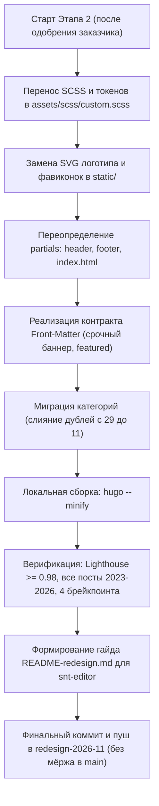

# План внедрения редизайна сайта СНТ «Орбита» (Этап 2)

> **Статус:** подготовлен по итогам Этапа 1 (прототипирование и векторная графика).  
> **Исполнитель:** Hugo-инженер (`snt-tech`) + Редактор (`snt-editor`) + Релиз-мастер (`snt-release`).  
> **Ветка:** `redesign-2026-11` (строго без прямого мёржа в `main`).

---

## 1. Архитектурное решение: корневые переопределения vs `themes/orbita/`

### Сравнение подходов

| Критерий | Вариант 1: Отдельная тема `themes/orbita/` | Вариант 2: Переопределения в `layouts/` + `assets/` (РЕКОМЕНДОВАНО) |
|---|---|---|
| **Правила GEMINI.md** | Требует создания новой независимой темы с нуля или копирования Stack | Строго следует правилу проекта: тема Stack остаётся нетронутым Git-подмодулем |
| **Объём кодовой базы** | Дублирование ~120 файлов шаблонов, локализации, поиска, сборщика ассетов | Изменяются только целевые partials (~6 файлов) и файл стилей `custom.scss` |
| **Обратная совместимость** | Высокий риск сломать скрытые зависимости Stack (шорткоды, пагинация, Pagefind) | 100% совместимость: весь внутренний движок Stack продолжает штатно работать |
| **Сложность поддержки** | При обновлении Hugo или правках темы нужно синхронизировать весь форк | Чистый и прозрачный diff: видны только кастомные изменения сайта «Орбита» |

### 🎯 Выбор и обоснование
**Выбран Вариант 2: переопределения в корне проекта (`layouts/` + `assets/scss/custom.scss`).**  
Тема `themes/hugo-theme-stack/` остаётся подключённым Git-подмодулем без каких-либо правок внутри. Все компоненты нового фирменного стиля накладываются поверх неё через стандартный механизм каскадного переопределения Hugo:
* `assets/scss/custom.scss` — дизайн-токены бренда, сетки, компоненты баннера и быстрых действий, стили тёмной темы.
* `layouts/index.html` — переопределение главной страницы (баннер, быстрые действия, лента новостей featured + compact list, темы, архив).
* `layouts/partials/header/` — шапка с новым векторным SVG-логотипом, оптимизированным меню, кнопкой поиска и темы.
* `layouts/partials/footer/` — футер с векторным логотипом, контактами правления и реквизитами.
* `static/orlogo.svg`, `static/logo_fav.png` — замена фавиконок и логотипов.

---

## 2. «Контракт данных»: Front-Matter для редактора

Чтобы новый дизайн был управляемым из Markdown-файлов без правки HTML-кода, для постов вводится стандартизированный набор параметров Front-Matter.

### 2.1. Срочное объявление в шапке главной страницы (Urgent Banner)

Служит для критически важных событий (голосования, аварии, отключения электричества, ремонт центрального въезда).

#### Параметры:
* `banner_urgent: true` (boolean, по умолчанию `false`) — флаг активации баннера на главной.
* `banner_title: "Текст заголовка"` (string, опционально) — короткий призыв к действию. Если не задан, берётся основной `title` поста.
* `banner_subtitle: "Пояснение для садоводов"` (string, опционально) — уточнение под заголовком. Если не задан, берётся `description`.
* `banner_badge: "до 20 июня"` (string, опционально) — плашка срока действия / статуса.
* `banner_expires: 2026-06-21T00:00:00+03:00` (ISO 8601 дата, опционально) — срок автоматического скрытия баннера.
* `banner_icon: "📣"` (string, по умолчанию `"📣"`) — эмодзи-иконка в левой части баннера.

#### Пример Front-Matter поста:
```yaml
---
title: "Начало общего голосования 2026 года"
date: 2026-05-15T10:00:00+03:00
slug: "nachalo-golosovaniya-2026"
categories: ["Выборы", "Важное"]

# Настройки срочного баннера на главной странице
banner_urgent: true
banner_title: "Приходите на голосование!"
banner_subtitle: "Выборы органов управления СНТ «Орбита» — важно участие каждого участка"
banner_badge: "до 20 июня"
banner_expires: 2026-06-21T00:00:00+03:00
banner_icon: "megaphone" # идентификатор векторной SVG-иконки (megaphone, alert, bell, vote)
---
```

#### Поведение по умолчанию:
Если `banner_urgent` не указан или `false`, пост публикуется обычной новостью. Если активных срочных постов несколько — выводится самый свежий по дате `date`.

---

### 2.2. Закреплённая новость в ленте (Featured Card)

Большая карточка в левой колонке новостной ленты с акцентным визуалом и анонсом.

#### Параметры:
* `featured: true` (boolean, по умолчанию `false`) — принудительно выводит статью в левую крупную карточку.
* `featured_badge: "Субботник 2026"` (string, опционально) — бейдж поверх изображения.
* `featured_icon: "leaf"` (string, опционально) — имя векторной SVG-иконки для стильной брендовой обложки при отсутствии прикреплённого фото.
* `weight: 1` (integer, опционально) — приоритет закрепления (чем меньше число, тем выше приоритет).

#### Пример Front-Matter:
```yaml
---
title: "Весенний субботник: сделаем наше СНТ чище!"
date: 2026-05-24T09:00:00+03:00
slug: "vesennij-subbotnik-2026"
categories: ["Объявления", "Благоустройство"]

featured: true
featured_badge: "Субботник 2026"
featured_icon: "leaf"
weight: 1
---
```

#### Поведение по умолчанию:
Если ни один пост не помечен `featured: true`, в крупную карточку автоматически выводится **самая последняя опубликованная статья** из раздела новостей.

---

### 2.3. Управление плитками быстрых действий и экстренной связью

Параметры настраиваются централизованно в `hugo.yaml` (в блоке `params`):

#### Конфигурация в `hugo.yaml`:
```yaml
params:
  # Экстренная связь / Сторож
  emergencyPhone: "+7 (921) 000-00-00"
  emergencyLabel: "Дежурный / Охрана"

  # Информативные плитки быстрых действий с микро-бейджами
  quickActions:
    - title: "Взносы"
      desc: "Реквизиты, сроки и порядок оплаты"
      icon: "card"
      badge: "2026 год"
      url: "/vznosy/"
    - title: "Электроэнергия"
      desc: "Показания счётчиков и перерывы"
      icon: "zap"
      badge: "Тариф 5.48 ₽"
      badgeColor: "amber"
      url: "/electro/"
    - title: "Документы"
      desc: "Протоколы собраний и отчёты"
      icon: "file-text"
      badge: "Устав и сметы"
      url: "/documents/"
    - title: "Контакты"
      desc: "Часы приёма, сторож и почта"
      icon: "phone"
      badge: "Правление"
      badgeColor: "green"
      url: "/contacts/"
```

---

## 3. План миграции категорий (слияние дублей)

### 3.1. Анализ текущего состояния контента
В существующих 77 статьях сайта зафиксировано **29 уникальных вариантов написания категорий**, вызванных разнобоем в регистре и числах:
* Дубли регистра: `новости` (8) и `Новости` (10); `объявление` (29), `Объявление` (7), `объявления` (2), `Объявления` (7); `важное` (27), `Важное` (7), `важно` (1); `правление` (6) и `Правление` (3); `собрание` (2), `Собрание` (3), `собрания` (1), `Собрания` (3); `дороги` (1) и `Дороги` (1); `безопасность` (1) и `Безопасность` (1); `память` (1) и `Память` (1).
* Единичные узкие теги: `мчс` (1), `происшествия` (1), `мастер-класс` (1), `досуг` (1), `дети` (1), `тарифы` (1), `анонс` (1), `рабочая группа` (1), `Рабочие группы` (1), `законодательство` (1).

### 3.2. Целевой классификатор (11 чистых категорий)

| Целевая категория | Включаемые исходные теги | Назначение |
|---|---|---|
| **Новости** | `Новости`, `новости`, `Жизнь СНТ`, `Сайт`, `Мнение`, `разное` | Текущие события и жизнь поселка |
| **Объявления** | `Объявления`, `объявления`, `Объявление`, `объявление`, `анонс` | Информационные сообщения для садоводов |
| **Важное** | `Важное`, `важное`, `важно` | Критичные уведомления и срочные сведения |
| **Собрания** | `Собрания`, `собрания`, `Собрание`, `собрание` | Общие собрания членов СНТ, повестки |
| **Правление** | `Правление`, `правление`, `отчет`, `законодательство` | Отчёты председателя и решения правления |
| **Выборы** | `Выборы`, `выборы` | Выборы председателя и ревизионной комиссии |
| **Дороги** | `Дороги`, `дороги`, `Рабочие группы`, `рабочая группа` | Ремонт подъездных путей и улиц |
| **Электричество** | `электричество`, `тарифы` | Учёт электроэнергии, счётчики, линии |
| **Благоустройство** | `Благоустройство`, `благоустройство` | Вывоз мусора, субботники, контейнеры |
| **Безопасность** | `Безопасность`, `безопасность`, `происшествия`, `мчс` | Пожарная безопасность, въезд, охрана |
| **Дети и досуг** | `дети`, `досуг`, `мастер-класс`, `поздравления`, `Память`, `память` | Праздники, детские секции, памятные акции |

### 3.3. Безопасный процесс миграции
1. Создаётся скрипт пакетной нормализации категорий в `content/post/**/index.md`.
2. В `hugo.yaml` настраиваются постоянные алиасы (псевдонимы) через Hugo taxonomy aliases, чтобы старые URL категорий (например, `/categories/объявление/`) автоматически перенаправлялись на `/categories/объявления/` через 301-редирект без образования битых ссылок (404).

---

## 4. Гарантии обратной совместимости (2023–2026)

Редизайн полностью сохраняет контракт работы со всеми опубликованными материалами сайта:
1. **URL-структура постов (`/p/:slug/`):**
   * Все постоянные ссылки неизменны. Hugo permalink конфигурация `post: /p/:slug/` остаётся в силе. Ни одна внешняя ссылка из дачных чатов WhatsApp/Telegram не будет утеряна.
2. **Page Bundles и медиа-файлы:**
   * Все вложенные изображения `image.png`, `cover.jpg`, прикрепленные PDF-файлы решений и смет внутри папок `content/post/<slug>/` продолжают отображаться в полном объеме.
3. **Hugo-шорткоды темы Stack:**
   * Полная поддержка встроенных шорткодов:
     * `` — стили адаптируются под новую палитру бренда;
     * `` — сохраняется адаптивное масштабирование;
     * `` — сохраняется колоночная вёрстка отчетов.
4. **Полнотекстовый поиск:**
   * Индекс поиска (Pagefind / Stork / Stork-search) пересобирается штатно, поле поиска в шапке передаёт поисковый запрос напрямую в существующий обработчик.
5. **RSS-лента и архивы:**
   * Файл `/index.xml` остаётся валидным RSS 2.0.
   * Архив публикаций по годам и месяцам сохраняет адресацию `/archives/`.

---

## 5. Пошаговый план работ Этапа 2



### Чек-лист приёмки Этапа 2:
- [ ] `/opt/homebrew/bin/hugo --minify` собирается с нулевым кодом ошибки.
- [ ] На главной отображается срочный баннер голосования и плитки быстрых действий.
- [ ] Логотип отображает точный векторный SVG (без растра).
- [ ] Контрастность текстов и дат по Lighthouse Accessibility ≥ 0.98.
- [ ] Проверена выборка старых постов за 2023, 2024, 2025 и 2026 годы — вёрстка и шорткоды идеальны.
- [ ] Все дубли категорий устранены, настроены редиректы.
- [ ] Подготовлен `README-redesign.md` с понятными инструкциями для редактора сайта.
