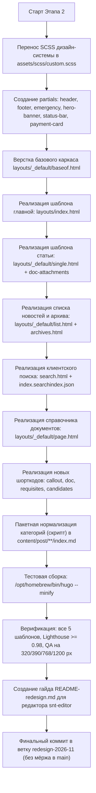

# Инженерный план реализации редизайна сайта СНТ «Орбита» (Этап 2)

> **Статус:** полностью готов к реализации (на основе комплексного дизайн-пакета от арт-директора).  
> **Исполнители:** Hugo-инженер (`snt-tech`) + Редактор (`snt-editor`) + Релиз-инженер (`snt-release`).  
> **Ветка Git:** `redesign-2026-11` (строго без прямого мёржа в `main` и без деплоя на сервер до приёмки).  
> **Дата актуализации:** 5 ноября 2026 г.

---

## 1. Состав дизайн-пакета и маппинг на шаблоны Hugo

В директории `.agents/tasks/2026-11-redesign/` (и `.agents/tasks/2026-11-redesign/new_design/`) сформирован исчерпывающий набор из 5 интерактивных макетов в единой дизайн-системе бренда (**Navy Ink `#17233b` + Cyan Accent `#06b6d4`**, светлая/тёмная темы, режим крупного шрифта **`А+`**, векторные контурные SVG-иконки, WCAG AAA контраст, адаптивность `320px–1920px`):

| Макет прототипа | Целевой шаблон Hugo | Назначение и закрываемые URL |
|---|---|---|
| `orbita-redesign.html` | `layouts/index.html` | **Главная страница портала (`/`)**: экстренная плашка связи с Правлением, Hero-баннер общего собрания с прогресс-баром кворума и Dual CTA, сводка статуса инфраструктуры и тарифов, сетка сервисов 3×2, реквизиты СНТ в 1 клик + модалка с QR-кодом СБП, главная новость + хронологическая лента, рубрики и архив по годам. |
| `orbita-article.html` | `layouts/_default/single.html` | **Страница новости / протокола / объявления (`/p/:slug/`)**: хлебные крошки, чипы рубрик, метаданные (дата, протокол, автор), блоки важных выносок (`callout`), карточки кандидатов, адаптивные таблицы, карточки скачивания вложений PDF/DOCX, кнопки «Поделиться» и «Распечатать» (`@media print`), перелинковка «Предыдущая / Следующая», правая колонка с оглавлением (`TableOfContents`), виджетом собрания и контактами. |
| `orbita-news-list.html` | `layouts/_default/list.html`<br>`layouts/_default/taxonomy.html`<br>`layouts/page/archives.html` | **Лента новостей, рубрики, теги и архив (`/post/`, `/categories/:slug/`, `/tags/:slug/`, `/archives/`)**: шапка со статистикой, фильтр по рубрикам и годам, группировка публикаций по годам (`2026`, `2025`, `2024–2023`), закреплённые (`pinned`) и срочные (`urgent`) новости, бейджи вложений (`PDF`), пагинация. |
| `orbita-search.html` | `layouts/page/search.html`<br>`layouts/index.searchindex.json` | **Страница умного живого поиска (`/search/`)**: клиентский поиск без стороннего бэкенда по новостям, страницам и PDF-документам, чипы частых запросов садоводов (`реквизиты`, `тариф`, `доверенность`, `устав`, `дорога`), фильтрация по типу результата (`Новости`, `Документы PDF`, `Разделы`), подсветка совпадений `<mark>`. |
| `orbita-documents.html` | `layouts/_default/page.html`<br>`layouts/page/documents.html` | **Справочно-сервисные страницы (`/documents/`, `/electro/`, `/pravlenie/`, `/komfort/`, `/contacts/`)**: карточки официальных документов с размером и форматом (`PDF`, `DOCX`), карточки тарифов АО «ПСК» на электроэнергию, состав Правления и комиссии, блок онлайн-обращений. |
| `orbita-mobile-check.html` | QA-инструмент | **Стенд проверки адаптивности**: селектор переключения всех 5 шаблонов, брейкпоинты `320px`, `390px`, `768px`, `1024px`, `1200px`, `1920px`, переключатель тем и режима крупного шрифта `А+`. |

---

## 2. Архитектурное решение темы Hugo

### 2.1. Принцип: корневые переопределения поверх подмодуля
В строгом соответствии с правилами проекта (`GEMINI.md`):
* Каталог `themes/hugo-theme-stack/` остаётся нетронутым Git-подмодулем.
* Все шаблоны, стили и компоненты нового дизайна размещаются в корневых директориях проекта:
  * `layouts/` — шаблоны страниц и partials;
  * `assets/scss/custom.scss` — дизайн-токены, сетки, компоненты и стили;
  * `static/` — статические файлы (логотипы, фавиконки, QR-коды);
  * `data/` — структурированные данные (список документов, сервисы).

### 2.2. Рекомендуемая файловая структура `layouts/`:
```text
layouts/
├── _default/
│   ├── baseof.html          # Базовый каркас: head, header, mobile-menu, footer, bottomnav, qrModal
│   ├── single.html          # Шаблон статьи / протокола (из orbita-article.html)
│   ├── list.html            # Шаблон списка новостей и рубрик (из orbita-news-list.html)
│   └── page.html            # Шаблон стандартных страниц (из orbita-documents.html)
├── page/
│   ├── archives.html        # Шаблон архива публикаций (/archives/)
│   ├── search.html          # Шаблон умного поиска (/search/)
│   └── documents.html       # Специализированный реестр документов
├── partials/
│   ├── header.html          # Шапка с каталогом разделов, экстренной плашкой и кнопками А+/тема
│   ├── emergency-strip.html # Экстренная плашка охраны для планшетов и мобильных
│   ├── hero-banner.html     # Условный баннер собрания с прогресс-баром кворума
│   ├── status-bar.html      # 4-карточная оперативная сводка инфраструктуры и тарифов
│   ├── quick-grid.html      # Сетка сервисов 3×2
│   ├── payment-card.html    # Блок реквизитов в 1 клик + модалка #qrModal
│   ├── article-aside.html   # Правая колонка статьи (Оглавление, виджет собрания, контакты)
│   ├── doc-attachments.html # Карточки скачивания файлов PDF/DOCX внизу статьи
│   └── footer.html          # Футер + мобильный таб-бар на 5 кнопок
├── shortcodes/
│   ├── callout.html         # Выноски info / warn / danger
│   ├── doc.html             # Карточка скачивания документа PDF/DOCX
│   ├── candidates.html      # Карточки кандидатов / членов Правления
│   ├── requisites.html      # Блок реквизитов с кнопками копирования
│   ├── alert.html           # Обратная совместимость старых статей
│   ├── figure.html          # Обратная совместимость старых статей
│   └── columns.html         # Обратная совместимость старых статей
├── index.html               # Главная страница (из orbita-redesign.html)
└── index.searchindex.json   # Генератор JSON-индекса для клиентского поиска
```

---

## 3. Конфигурационный контракт `hugo.yaml`

Для полного управления сезонными баннерами, реквизитами и тарифами без правок HTML в `hugo.yaml` внедряются структурированные секции:

```yaml
# Параметры СНТ (используются в шапке, плашках и футере)
snt:
  name: 'СНТ «Орбита»'
  location: 'д. Малое Карлино, Ломоносовский р-н'
  fullAddress: '188508, Ленинградская обл., Ломоносовский р-н, Виллозское ГП, д. Малое Карлино, тер. СНТ «Орбита»'
  chairman: 'Витер Андрей Дмитриевич'
  plotsCount: 334
  phoneDisplay: '+7 (921) 967-06-42'
  phoneTel: '+79219670642'
  receptionHours: 'Сб 12:00–14:00'
  email: 'sntorbita56@yandex.ru'
  newsEmail: 'news@cnt-orbita.ru'
  maxChannelUrl: 'https://max.ru/id4720008674_biz'
  lenenergoPhone: '8 (800) 220-02-20'
  pskPhone: '8 (812) 678-96-00'
  pskCabinetUrl: 'https://ikus.pesc.ru/auth/login'

# Банковские реквизиты (для модалки СБП и карточки оплаты)
requisites:
  enabled: true
  inn: '4720008674'
  kpp: '472501001'
  account: '40703810155240000156'
  bank: 'Северо-Западный банк ПАО Сбербанк'
  bik: '044030653'
  corrAccount: '30101810500000000653'
  purposeTemplate: 'Целевой и членский взнос за 2026 год, участок № ___'
  paymentTableUrl: 'https://docs.google.com/spreadsheets/d/1zhGuLnfFQLzfv22SANlKMt_76mLHWN2umiCzYl9Nk64/edit?usp=sharing'
  qrImageUrl: '/vznosy/qr-oplata.png'

# Экстренная верхняя полоса (.emergency-strip)
emergencyStrip:
  enabled: true
  mode: 'normal' # 'normal' (зелёный индикатор) или 'alert' (янтарный при ЧП)
  title: 'Правление СНТ «Орбита» · Приём: Сб 12:00–14:00'
  subtitle: 'Аварийная «Ленэнерго»: 8 (800) 220-02-20 · Показания ПСК: 8 (812) 678-96-00'

# Главный Hero-баннер собрания (.hero-banner)
heroBanner:
  enabled: true
  expiresAt: '2026-07-05T23:59:59+03:00' # Автоматическое скрытие после окончания
  tag: 'Общее собрание 2026'
  datesLabel: 'Заочно: 20 июня – 3 июля · Очно: 4 июля в 12:00'
  title: 'Очередное общее собрание членов СНТ «Орбита» (очно-заочное голосование)'
  description: 'Выборы Председателя, членов Правления (5 кандидатов) и Ревизионной комиссии, утверждение сметы 2026 года.'
  showProgress: true
  progressLeftLabel: 'Территория СНТ: 334 участка (д. Малое Карлино)'
  progressRightLabel: 'Бюллетени: в Правлении Сб 12:00–14:00'
  progressPercent: 68
  primaryBtn:
    text: 'Порядок голосования 2026'
    url: '/p/nachalo-golosovaniya-2026/'
  secondaryBtn:
    text: 'Список кандидатов (Протокол №31)'
    url: '/p/utverzhden-spisok-kandidatov-2026/'

# Оперативная сводка инфраструктуры и тарифов (.status-bar)
statusBar:
  enabled: true
  items:
    - dot: 'ok'
      label: 'Тарифы АО «ПСК» (до 1500 кВт·ч)'
      value: 'День 7,25 ₽ · Ночь 3,95 ₽ · Единый 6,59 ₽'
    - dot: 'ok'
      label: 'Передача показаний света'
      value: 'С 1 по 25 число · 8 (812) 678-96-00'
    - dot: 'info'
      label: 'Аварийная «Ленэнерго»'
      value: 'Отключение света: 8 (800) 220-02-20'
    - dot: 'info'
      label: 'Приём в доме Правления'
      value: 'Суббота 12:00–14:00 · Витер А.Д.'

# Генерация поискового индекса
outputs:
  home:
    - HTML
    - RSS
    - SearchIndex
outputFormats:
  SearchIndex:
    mediaType: "application/json"
    baseName: "searchindex"
    isPlainText: true
    notAlternative: true
```

---

## 4. Контракт Front-Matter для статей (`archetypes/post.md`)

```yaml
---
title: "Заголовок новости или протокола"
slug: "slug-stati"
date: 2026-06-05T12:00:00+03:00
description: "Краткий анонс статьи для ленты и поисковых сниппетов."

# Рубрика (одна из 7 канонических) и теги
categories:
  - "sobraniya"
tags:
  - "Протокол №31"
  - "Выборы 2026"

# Флаги вывода в лентах:
featured: true         # Главная крупная карточка на главной
pinned: false          # Закрепить вверху общего списка новостей
urgent: false          # Выделить янтарным цветом при ЧП

# Метаданные шапки статьи:
protocol: "Протокол Правления №31"
event_date: "Голосование: 20 июня – 4 июля 2026"
author: "Правление СНТ «Орбита»"

# Управление сайдбаром:
show_toc: true
show_voting_widget: true

# Прикреплённые документы:
attachments:
  - title: "Протокол заседания Правления №31"
    file: "/documents/protokol-31-2026.pdf"
    ext: "pdf"
    size: "420 КБ"
    note: "Скан с подписью и печатью"
---
```

---

## 5. Нормализация таксономий: 7 чистых канонических рубрик

Для устранения накопившегося разнобоя (29 вариантов регистра и падежей) все статьи нормализуются к 7 каноническим рубрикам с настройкой taxonomy aliases:

| Slug | Название | Объединяемые старые категории |
|---|---|---|
| `vazhnoe` | **Важное и срочное** | `Важное`, `важное`, `Важно`, `важно`, `Срочно`, `Взаимопомощь` |
| `sobraniya` | **Собрания и выборы** | `Собрание`, `собрание`, `Собрания`, `собрания`, `Голосование`, `Выборы`, `выборы` |
| `pravlenie` | **Правление и отчёты** | `Правление`, `правление`, `Отчеты`, `отчет`, `Объявление`, `объявление`, `Объявления`, `Новости`, `новости`, `Сайт` |
| `dorogi` | **Дороги и благоустройство** | `Дороги`, `дороги`, `Рабочая Группа`, `Рабочие группы`, `Субботник`, `Благоустройство`, `благоустройство` |
| `electro` | **Электроэнергия и тарифы** | `Электроэнергия`, `электричество`, `Свет`, `Тарифы`, `тарифы` |
| `bezopasnost` | **Пожарная безопасность и МЧС** | `Безопасность`, `безопасность`, `Пожарная безопасность`, `МЧС`, `мчс`, `происшествия` |
| `zhizn-snt` | **Праздники и жизнь СНТ** | `Мероприятия`, `Творчество`, `мастер-класс`, `досуг`, `дети`, `Память`, `память`, `Бессмертный полк`, `История` |

---

## 6. Гарантии 100% обратной совместимости (2023–2026)

1. **Неизменность URL-схемы:** `permalinks.post: /p/:slug/` остаётся в силе. Все старые ссылки из мессенджеров MAX, Telegram и WhatsApp продолжают открывать статьи без `404`.
2. **Статические разделы:** сохраняются пути `/vznosy/`, `/electro/`, `/documents/`, `/pravlenie/`, `/komfort/`, `/contacts/`, `/archives/`, `/search/`.
3. **Шорткоды:** сохраняется полная работоспособность `alert`, `figure`, `columns` для всех опубликованных постов 2023–2026 гг.
4. **Page Bundles:** все вложенные изображения и сканы протоколов отображаются корректно.
5. **RSS:** генерация `/index.xml` остаётся валидным RSS 2.0.

---

## 7. Пошаговый сценарий реализации Этапа 2



### Чек-лист приёмки Этапа 2:
- [ ] Сборка `/opt/homebrew/bin/hugo --minify` проходит без ошибок за < 300 мс.
- [ ] Главная страница содержит рабочий Hero-баннер кворума, сводку статусов, реквизиты с модалкой СБП.
- [ ] Шаблон статьи `/p/:slug/` содержит оглавление, метаданные, карточки вложений PDF/DOCX и печать `@media print`.
- [ ] Список новостей `/post/` корректно группирует статьи по годам с фильтрацией.
- [ ] Живой поиск `/search/` мгновенно фильтрует результаты по JSON-индексу с подсветкой `<mark>`.
- [ ] Кнопка «А+» увеличивает шрифт до 114% на всех страницах с запоминанием в `localStorage`.
- [ ] Тёмная тема работает бесшовно на всех страницах сайта.
- [ ] Проверены старые посты за 2023, 2024, 2025 и 2026 годы — вёрстка и ссылки 100% стабильны.
