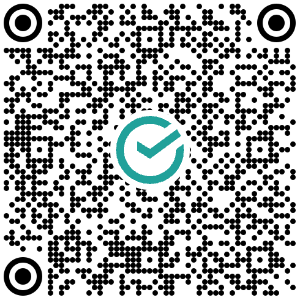

Информация по оплате членских и целевых взносов.

# 💳 Банковские реквизиты


| Параметр | Значение |
| :--- | :--- |
| **Получатель** | СНТ «Орбита» |
| **ИНН** | 4720008674 |
| **КПП** | 472501001 |
| **Расчетный счет** | **40703810155240000156** |
| **Банк** | СЕВЕРО-ЗАПАДНЫЙ БАНК ПАО СБЕРБАНК |
| **БИК** | **044030653** |
| **Корр. счет** | **30101810500000000653** |


# 📱 QR-код для оплаты

Отсканируйте QR-код камерой телефона для быстрой оплаты:

# ✍️ Назначение платежа

При оплате **обязательно** укажите назначение платежа:


**Целевой и членский взнос за \_\_\_\_ год, участок № \_\_\_\_**



Многие путаются и пытаются самостоятельно рассчитать и указать в платежке размер целевого и размер членского взноса. **Это не нужно** — бухгалтерия сама всё посчитает. Достаточно указать назначение платежа по образцу выше.


# 📊 Таблица по взносам

Состояние оплаты взносов по каждому участку можно проверить в онлайн-таблице:

[**Открыть таблицу по взносам (Google Sheets)**](https://docs.google.com/spreadsheets/d/1zhGuLnfFQLzfv22SANlKMt_76mLHWN2umiCzYl9Nk64/edit?usp=sharing)

# ❓ Вопросы

Основные вопросы по взносам — к **правлению**:

- Телефоны:
    - **+7 (981) 705-36-35**
    - **+7 (921) 967-06-42**
- E-mail: **sntorbita56@yandex.ru**

_С уважением, Правление СНТ «Орбита»_
